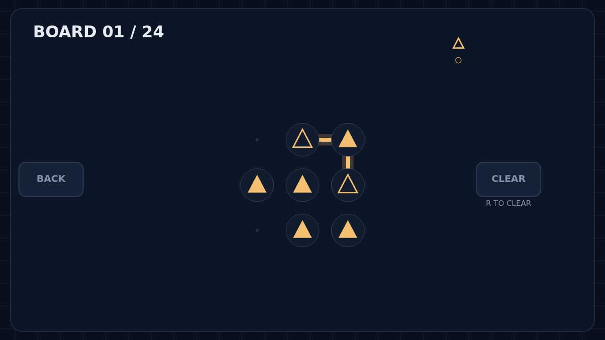

# Refract

Draw light across a dark optical bench. Start at an outlined emitter, drag from node to neighboring node, and guide your beam to its matching partner. Diagonal steps open clever routes, but beams cannot cross or share a segment.

Every solid lens of a channel must join its beam. Crystals belong to no channel: any beam may pass through, and each charge has to be used exactly once. Release a partial route to think, then grab it again, trim it, or clear the whole board.

Play through 24 crafted Campaign puzzles that build from a single color to crowded, shared crystal layouts. Or enter Cascade for an endless run of boards that grows denser and more demanding as you solve.

